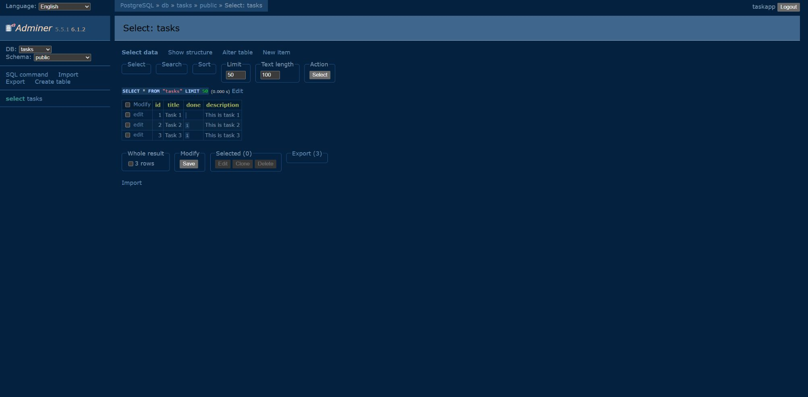

# Task API

A Java 17 REST API for tasks, backed by PostgreSQL. Docker Compose starts the API and database together. Routes, validation, and JSON responses are carried over from A1/A2.

## Install and run

Install and start Docker Desktop with Linux containers enabled. Open a new terminal after installing it. Java and Maven run inside the API container.

Copy the local configuration once:

```powershell
Copy-Item .env.example .env
```

Start the whole stack:

```powershell
docker compose up
```

The first run downloads images, builds the app, creates the table, and seeds three tasks. Compose waits for Postgres readiness before starting the API.

- API: http://localhost:3000
- Tasks: http://localhost:3000/tasks
- Swagger UI: http://localhost:3000/docs

`run.ps1` is also a shortcut for `docker compose up`. After changing Java source or dependencies, use `docker compose up --build`. Internet access is needed for initial downloads and Swagger UI's browser assets.

## Environment variables

[.env.example](.env.example) contains local-development placeholders. Keep real values in the git-ignored `.env`:

| Variable | Purpose |
| --- | --- |
| `POSTGRES_PASSWORD` | Bootstrap administrator password |
| `APP_DB_PASSWORD` | Password for the separate `taskapp` API login |
| `DATABASE_URL` | PostgreSQL JDBC connection string used by Java |

Keep the password in `DATABASE_URL` identical to `APP_DB_PASSWORD`. The database hostname inside Compose is `db`. `.env` is excluded from Git and the Docker build context. Credentials are supplied through the environment. Changing `.env` does not update passwords already initialized in an existing database volume.

## Storage

The `db` service uses the official `postgres:17` image. Its named `taskdata` volume is mounted at `/var/lib/postgresql/data`, so rows outlive the containers.

`TaskStore.java` contains all database operations. It creates `tasks` with `id SERIAL PRIMARY KEY`, `title TEXT`, and `done BOOLEAN`. A nullable `description TEXT` column preserves descriptions on A1/A2's seeded examples. New tasks still return `id`, `title`, and `done`. Three examples are inserted only when the table is empty; restarting a populated database does not duplicate them.

JDBC prepared statements bind client values with `?` placeholders. The API login owns its database but has no superuser, role-creation, or database-creation privileges. The old SQLite `tasks.db` is left intact; this stack uses Postgres.

## Endpoints

| Method | Endpoint | Purpose | Success | Errors |
| --- | --- | --- | --- | --- |
| `GET` | `/` | API name, version, and task endpoint | `200` | - |
| `GET` | `/health` | API liveness | `200` | - |
| `GET` | `/tasks` | List tasks | `200` | - |
| `POST` | `/tasks` | Create from a JSON `title` | `201` | `400` |
| `GET` | `/tasks/:id` | Read one task | `200` | `404` |
| `PUT` | `/tasks/:id` | Update `title` and/or `done` | `200` | `400`, `404` |
| `DELETE` | `/tasks/:id` | Delete a task | `204` | `404` |
| `GET` | `/docs` | Interactive Swagger UI | `200` | - |
| `GET` | `/openapi.json` | Existing OpenAPI contract | `200` | - |

Invalid-body and missing-task responses contain a JSON `error` message. Successful deletion has an empty body.

## Curl evidence

```text
PS> curl.exe -s -i http://localhost:3000/tasks
HTTP/1.1 200 OK
Date: Sat, 17 Oct 2026 18:25:55 GMT
Content-type: application/json; charset=utf-8
Content-length: 209

[{"id":1,"title":"Task 1","description":"This is task 1","done":false},{"id":2,"title":"Task 2","description":"This is task 2","done":true},{"id":3,"title":"Task 3","description":"This is task 3","done":true}]
```

The full CRUD run, including 201/200/204/400/404 responses, is saved in [docs/curl-checks.txt](docs/curl-checks.txt).

## Inspect Postgres

```powershell
docker compose exec db psql -U postgres -d tasks -c '\dt' -c 'SELECT id, title, done, description FROM tasks;'
```

This screenshot shows the three seeded rows in Postgres through a temporary local database viewer. The submitted stack uses the `api` and `db` services.



Example query:

```sql
SELECT * FROM tasks WHERE done = TRUE;
```

More examples are in [docs/queries.sql](docs/queries.sql). Use a disposable test schema for its update-all and delete statements.

## Verification

With the stack running:

```powershell
docker compose exec api mvn -q test-compile exec:java "-Dexec.mainClass=ApiCheck" "-Dexec.classpathScope=test"
```

The checks create a uniquely named temporary schema and remove it afterward. They check table creation, repeated seed initialization, CRUD, validation, SQL-looking titles, partial updates, JSON errors, empty 204 bodies, and persistence after reconnecting. They do not modify `public.tasks`.

A clean checkout with the current changes was also started using a copy of `.env.example`. It created exactly three tasks, kept exactly three after three API-container restarts, and passed the same verification program.

Full-stack persistence was checked separately: a task was created and completed through the API, then the stack was stopped and recreated:

```powershell
docker compose down
docker compose up -d --wait
```

The same ID, updated title, and completion status remained. Do not add `--volumes` when testing persistence: that option removes stored database data.

## Section 6 requirements

- [x] Postgres runs in a container; one `docker compose up` starts both services.
- [x] The ignored `.env` supplies `DATABASE_URL`; `.env.example` lists the required keys.
- [x] Missing tables are created automatically; three examples are seeded only when empty.
- [x] Five CRUD endpoints use parameterized Postgres queries and retain their response shapes.
- [x] Success codes are 200/201/204; invalid bodies and unknown IDs return JSON 400/404 errors.
- [x] A named volume preserves data across a full Compose down/up.
- [x] README includes startup, environment variables, endpoint table, curl output, and database screenshot.
- [ ] Push the stage commits to the public GitHub repository.

Optional extras and the bonus stage are not included.

## Swagger UI

Swagger UI documents task endpoints and lets you send requests from the browser.


