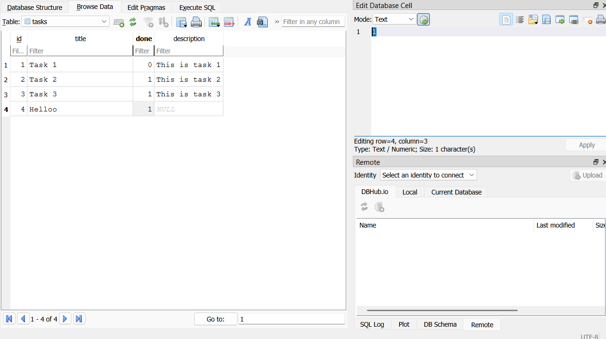
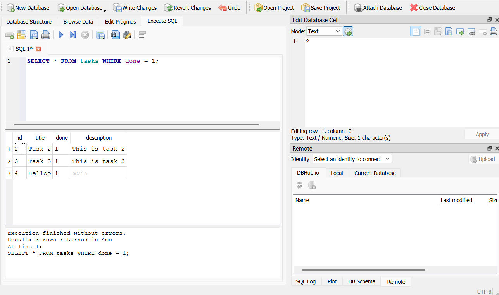
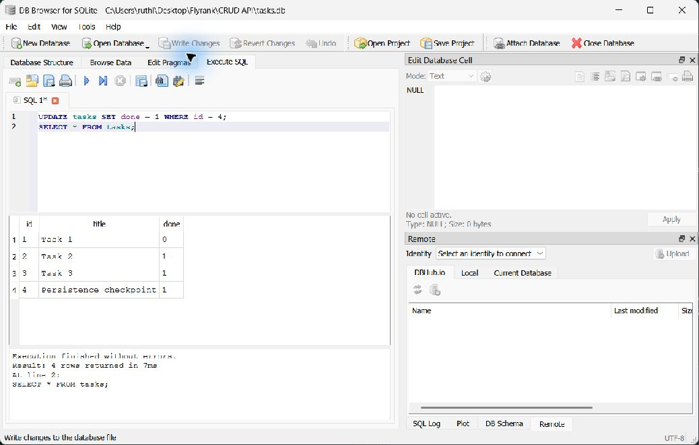

# Task API

A small Java 17 REST API for creating, reading, updating, and deleting tasks. It uses Java's HTTP server, SQLite JDBC for storage, and Gson for JSON. Interactive OpenAPI documentation is available through Swagger UI.

## Install and run

Install JDK 17 or newer and put its `java` and `javac` commands on PATH. From the project directory on Windows, run:

```powershell
.\run.ps1
```

The API runs at `http://localhost:3000`, and Swagger UI is available at `http://localhost:3000/docs`.

The script selects the JDK on PATH and uses the included Maven wrapper to download Maven and the Java dependencies on the first run. Internet access is needed for that download and for Swagger UI's browser assets. Stop the server with Ctrl+C.

On macOS or Linux, set `JAVA_HOME` to your JDK and run `./mvnw -q compile exec:java`.

## SQLite storage

SQLite keeps the database in one file, needs no separate database server, and saves changes across server restarts. The app creates `tasks.db` in the project directory and creates the `tasks` table automatically. The file is git-ignored, so a fresh clone creates its own database.

The table has `id INTEGER PRIMARY KEY`, `title TEXT`, and `done INTEGER`. An additional nullable `description TEXT` column preserves the optional descriptions on A1's example tasks. SQLite stores `done` as 0 or 1; the API returns a JSON boolean. The database assigns new IDs. Three example tasks are inserted only when the table is empty, so restarting a populated database does not duplicate them.

Request bodies are unchanged. Seed responses retain their `description`; new tasks return `id`, `title`, and `done`, just as in A1. An existing three-column `tasks.db` is upgraded automatically without deleting its rows. All values supplied by clients are bound through JDBC prepared statements.

## Endpoints

| Method | Endpoint | Description | Success | Errors |
| --- | --- | --- | --- | --- |
| `GET` | `/` | Show API name, version, and task endpoint | `200` | — |
| `GET` | `/health` | Check whether the API is running | `200` | — |
| `GET` | `/tasks` | List all tasks | `200` | — |
| `POST` | `/tasks` | Create a task from a JSON `title` | `201` | `400` |
| `GET` | `/tasks/:id` | Get one task by ID | `200` | `404` |
| `PUT` | `/tasks/:id` | Update a task's `title` and/or `done` value | `200` | `400`, `404` |
| `DELETE` | `/tasks/:id` | Delete a task | `204` | `404` |
| `GET` | `/docs` | Open the interactive Swagger UI | `200` | — |

## Example response

```text
PS> curl.exe -s -i http://localhost:3000/health
HTTP/1.1 200 OK
Content-Type: application/json; charset=utf-8
Content-Length: 15

{"status":"OK"}
```

## Database inspection and SQL

Open the project's `tasks.db` in DB Browser for SQLite and select **Browse Data**, then the `tasks` table. This screenshot shows the three seeds and a task created through the API, still present after restarting the Java process:



In **Execute SQL**, this query returned Task 2 and Task 3, the two completed seed tasks:

```sql
SELECT * FROM tasks WHERE done = 1;
```



After creating the verification task with ID 4, `UPDATE tasks SET done = 1 WHERE id = 4;` was run in DB Browser and saved with **Write Changes**. `GET /tasks/4` immediately returned `done: true`, without restarting the API.



The five Stage 4 queries are saved in [docs/queries.sql](docs/queries.sql). The update-all and delete statements are checked against a disposable database by the verification program.

## Verification

With `JAVA_HOME` pointing to your JDK, run:

```powershell
.\mvnw.cmd -q test-compile exec:java "-Dexec.mainClass=ApiCheck" "-Dexec.classpathScope=test"
```

This uses a temporary database and an available port. It checks automatic setup, three seed restarts, all CRUD endpoints, invalid JSON and field types, partial updates, SQL-looking titles, live direct SQL changes, empty 204 bodies, and persistence after closing and reopening the server and database. It never modifies the project's database.

The running app was also checked with `curl.exe -i`: create returned 201, reads and updates returned 200, deletion returned an empty 204, missing tasks returned JSON 404 errors, and an empty title returned a JSON 400 error. A task created before stopping the Java process was returned after starting it again.


## Swagger UI

Swagger UI documents all task endpoints and lets you send requests from the browser.


